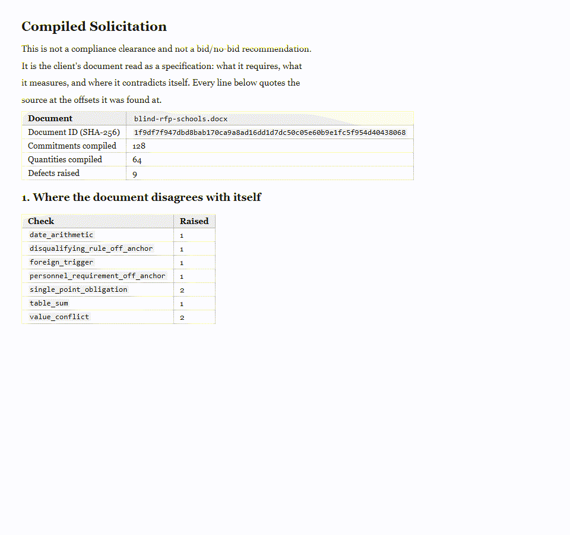
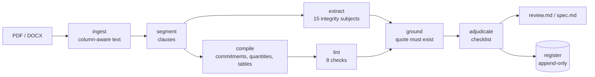

# cgate

Tender documents contradict themselves, and a clause-by-clause reader never sees it. cgate compiles a solicitation into typed commitments and quantities, checks the document against itself, and quotes the source text for every finding.



*`cgate spec` and `cgate review` on the invented tender in `examples/`: findings with verbatim quotes, then the 15-item checklist. Rendered from the demo output.*

## Quickstart

No API key is needed for anything below. The review path makes no model calls and no network calls.

Python 3.11 or newer.

```bash
# bash
python -m venv .venv && source .venv/bin/activate
pip install -e ".[dev,serve]"
python -m cgate demo --out out/demo
```

```powershell
# PowerShell
python -m venv .venv; .\.venv\Scripts\Activate.ps1
pip install -e ".[dev,serve]"
python -m cgate demo --out out/demo
```

The demo exits 0 and writes `out/demo/review.md`, `out/demo/spec.md` and `out/demo/register.db`.

Run the steps by hand:

```bash
python -m cgate spec   examples/blind-rfp/blind-rfp-schools.docx --out out/spec     # compile + lint
python -m cgate review examples/blind-rfp/blind-rfp-schools.docx --out out/review   # 15-item checklist
python -m pytest -q                                                                  # tests
ruff check .                                                                         # lint
```

On Windows, use `\` in paths if your shell needs it.

Your own document: pass a PDF, DOCX, TXT or MD file to `spec` or `review`. Documents are read locally and are not sent anywhere.

## What it does



- **Compiles the document.** Every sentence with a modal verb becomes a commitment; every number with a unit becomes a quantity; tables are kept as tables.
- **Lints it against itself.** Checks: `value_conflict`, `date_arithmetic`, `table_sum`, `foreign_trigger`, `disqualifying_rule_off_anchor`, `personnel_requirement_off_anchor`, `single_point_obligation`, and dangling or external references.
- **Quotes, or says nothing.** A finding whose quoted words cannot be found at the cited offsets in the source is deleted, not downgraded.
- **Never clears anything.** The 15-item checklist has no "passed" status. Items that need outside evidence are listed under "what this review did not establish".
- **Keeps a register.** SQLite, append-only through triggers, hash-chained. `decide` refuses a system actor and refuses to close a pursuit with no outcome.
- **Runs the review clocks.** Notification and review deadlines in business days, with values in `config/procedure.example.yaml`.
- **Checks your own submission.** `cgate submission` marks up an outgoing proposal: absolute claims, undeclared parties, unmatched commitments.
- **Reads columns correctly.** Two-column PDFs are reconstructed before anything else runs; interleaved columns would break every later stage.

More: [docs/ARCHITECTURE.md](docs/ARCHITECTURE.md), [docs/blind-test.md](docs/blind-test.md), [docs/public-tender-evaluation.md](docs/public-tender-evaluation.md), [docs/word-addin.md](docs/word-addin.md).

## What is synthetic

Everything in the repository is invented: the tender (a fictional foundation and country), the proposal ("Example Engineering Ltd"), the bench fixtures, the checklist wording and the procedure values. Emails use `.example`, phones use `+000` or an unassigned country code.

Regenerate the generated files (the `.docx` files, `tests/fixtures/tender_body.txt`, `bench/fixtures/gc_*`):

```bash
python examples/make_sample.py --out examples
```

`examples/blind-rfp/blind-rfp-schools.md` and `examples/blind-rfp/PLANTED-DEFECTS.md` are committed sources, not generated.

## Status

Experimental. What the repository itself shows, from the runs recorded for this edition:

- Test suite: `396 passed, 2 skipped, 0 failed` (`python -m pytest -q`). The two skips: one test needs the reference corpus fetched, one needs a fixture feature the sample does not have.
- Blind test: `tests/test_blind_rfp.py`, 12 tests, all six planted defects found; the engine raises 9 findings, all on planted defects. See [docs/blind-test.md](docs/blind-test.md).
- Bench: three invented fixtures, 23 of 23 labelled provisions found. The labels were written by the same author as the lexicon, so this is a regression check, not an accuracy claim.
- **Real documents:** a run recorded on 2026-10-21 over **134 real procurement notices** published for open international competition, from 50 countries. 134 of 134 processed without an error. **2 substantive findings**, both `external_reference` and both correct. This run needs network access and the fetched notices to reproduce; it was not re-verified offline for this edition. See [docs/public-tender-evaluation.md](docs/public-tender-evaluation.md).
- **How it got there:** in that same run the first pass raised 38 findings; a hand-check of 12 found **0 genuine defects, 2 extraction bugs and 10 artefacts of document class**. Four bugs were then fixed and the count fell to 2. The before/after, the verdicts and the fixes are in [docs/public-tender-handcheck.md](docs/public-tender-handcheck.md). The fixed bugs are in the code and covered by `tests/test_public_regressions.py`, which runs offline.
- Node checks for the add-in's pure logic run as part of the suite.

Not established here: accuracy on full real solicitations (the public corpus is notices, which are summaries — `bench/public/evaluate.py` fetches and reports them, and the handcheck explains what that does and does not support), other languages, scanned PDFs, or layouts the fixtures do not cover. The Word add-in (Windows only), the Ollama drafter and sanctions screening are optional and lightly tested.


Optional pieces, all off by default:

| Piece | How to turn on | Key |
|---|---|---|
| Word add-in | [docs/word-addin.md](docs/word-addin.md) | none |
| Replacement-text drafter (local Ollama) | `CGATE_OLLAMA_URL`, `CGATE_DRAFT_MODEL` | none |
| Sanctions screening (OpenSanctions) | `OPENSANCTIONS_API_KEY` (bring your own) | yes |

The drafter can propose wording for a human to accept. It cannot produce a finding, a status or a decision.

## Origin

Built for internal use at an engineering consultancy; this edition is cleaned and runs on synthetic data.

## Licence

MIT, see [LICENSE](LICENSE). Third-party notices (PyMuPDF is AGPL-3.0; add-in fonts are OFL) are in [NOTICE](NOTICE).
