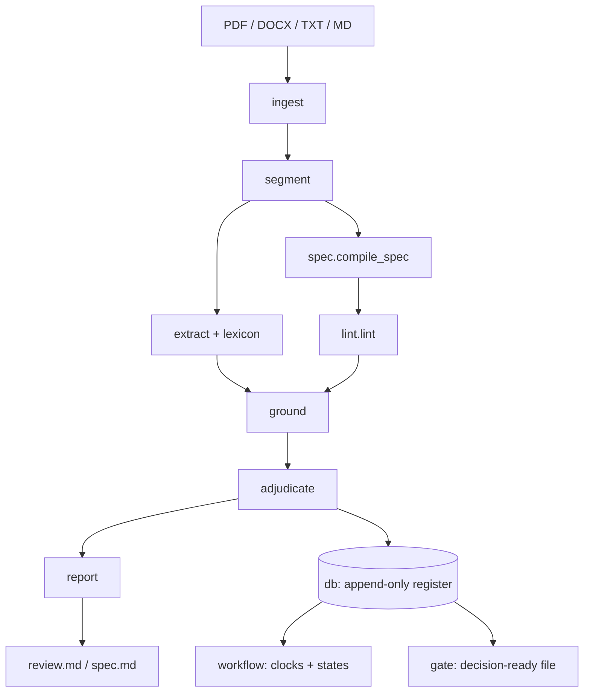

# Architecture

cgate has two jobs that share one parser: read a solicitation against a fixed
checklist (`review`), and read it against itself (`spec`). Neither calls a
language model. Same input, same output, which is what lets a review be
reproduced later.



## Stages

| Stage | Module | What it does |
|---|---|---|
| ingest | `ingest.py` | PyMuPDF for PDF, python-docx for DOCX. Rebuilds reading order in multi-column layouts. Everything downstream inherits mistakes made here. |
| segment | `segment.py` | Joins lines into clauses using the document's own numbering, so cross-references ("as defined in 6.8") can be followed. |
| compile | `spec.py` | Every modal sentence becomes a commitment with a type and an owner. Every number with a unit becomes a quantity. Tables are kept. |
| lint | `lint.py` | Checks that cannot be asked of one clause at a time. See below. |
| extract | `extract.py`, `lexicon.py` | Rules (patterns and word lists) that tag clauses with one of 15 integrity subjects. Surface forms use role words ("the Purchaser", "the Client"); add your own under `agency_aliases` in config. |
| ground | `ground.py` | A finding must quote text that exists at the cited offsets. If it does not, the finding is deleted. |
| adjudicate | `adjudicate.py` | Maps requirements to the 15 checklist items. The strongest status is `evidence_present`. There is no "cleared". |
| report | `report.py` | Renders `review.md`: summary table, a "what this review did not establish" section above the detail, then per-item evidence. |

## The lint checks

| Check | Reads | Example from the sample tender |
|---|---|---|
| `value_conflict` | two numbers for one quantity | bid validity 90 vs 120 days |
| `date_arithmetic` | which number the document's own dates pick | a security date that only works with 120 days |
| `table_sum` | a percentage column | payment schedule totals 95 |
| `foreign_trigger` | a payment tied to someone else's act | milestone 4: "Award of the works contract by the Foundation" |
| `disqualifying_rule_off_anchor` | a bid-ending rule filed in the wrong section | currency rule inside the evaluation section |
| `personnel_requirement_off_anchor` | a duty on a role, stated away from that role | Team Leader language requirement in a reporting paragraph |
| `single_point_obligation` | a binding duty stated exactly once | insurance cover only in the terms of reference |
| dangling / external reference | a reference to an annex or clause that does not exist | not raised on the sample |

## Register and workflow

`db.py` and `schema.sql` hold a SQLite register. Triggers reject UPDATE and DELETE
on `ledger` and `decision`. A CHECK constraint rejects a decision with an empty
actor or signature. Ledger rows are hash-chained, and `cgate register verify`
walks the chain. In code, `decide` refuses system actors and refuses to close a
pursuit that has no recorded outcome.

`workflow.py` implements the states (notified, under review, information
requested with the clock paused, cleared / conditionally cleared / held, closed)
and the clocks in business days. Values come from `config/procedure.example.yaml`.
Copy it and set `CGATE_CONFIG` to change them. All values in the repository are
invented.

`gate.py` assembles one file per pursuit in the order a reviewer reads it.
`screen.py` queries a sanctions dataset (optional, needs `OPENSANCTIONS_API_KEY`).
`conflict.py` finds shared text between documents. `submission.py` marks up an
outgoing proposal.

## Server and add-in

`serve.py` is a FastAPI app bound to `127.0.0.1:8765` over TLS (`certs.py` issues
a self-signed localhost certificate). It writes the same `review.json` and
`review.md` as the CLI and has no authentication, because it is bound to
loopback. See [word-addin.md](word-addin.md).

## Optional model use

`draft.py` can ask a local Ollama model for replacement wording. It is not
reachable from `run_review`, `adjudicate` or `report`. A model may propose words
for a person to accept. It may not produce a finding, a status or a decision.

## Layout

```
cgate/      engine, register, server, CLI
config/     checklist.example.yaml, procedure.example.yaml
examples/   invented tender and proposal, make_sample.py
bench/      invented fixtures with hand-written expectations
corpus/     sources.example.yaml (example.invalid URLs; fetched files are git-ignored)
addin/      Word task pane (Office.js)
tests/      pytest suite + node checks for the add-in's pure logic
```
